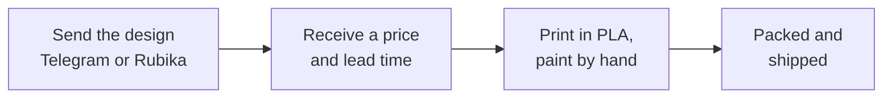
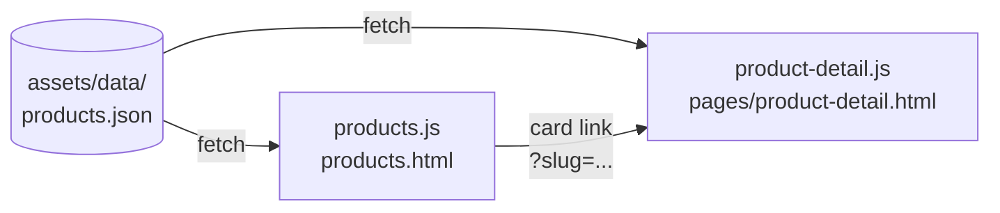

<p align="center">
  
</p>

<p align="center">
  &nbsp;&nbsp;
  &nbsp;&nbsp;
  
</p>

<p align="center">
  <a href="https://kourosh2043.github.io/PrinterLand_Project/"><b>View the live site</b></a>
</p>

# PrinterLand

PrinterLand is a Persian, right-to-left website for a small custom 3D-printing business. Models are printed in PLA, selected pieces are painted by hand with acrylic paint, and customers place orders by messaging the owner on Telegram or Rubika. The site explains the services, walks through the ordering process, lists products, shows finished work, and answers the questions customers ask most.

The whole project is static HTML, CSS and vanilla JavaScript. It has no framework, no bundler and nothing to install.

| | |
| --- | --- |
| Language | Persian (`lang="fa"`, `dir="rtl"`) |
| Stack | HTML, CSS, JavaScript (ES5/ES6, no libraries) |
| Data | `assets/data/products.json` |
| Font | Vazirmatn, 9 weights, bundled as `.woff2` |
| Themes | Dark (default) and light |
| Orders | Telegram and Rubika, no backend |
| Live site | [kourosh2043.github.io/PrinterLand_Project](https://kourosh2043.github.io/PrinterLand_Project/) |

## Contents

- [Tech stack](#tech-stack)
- [Pages](#pages)
- [Features](#features)
- [Design](#design)
- [How it works](#how-it-works)
- [Project structure](#project-structure)
- [Run it locally](#run-it-locally)
- [Customizing the site](#customizing-the-site)
- [Current state](#current-state)
- [Contact](#contact)

## Tech stack

<table>
  <tr>
    <th></th><th align="left">Language or format</th><th align="left">Files</th><th align="left">Lines</th><th align="left">What it does here</th>
  </tr>
  <tr>
    <td></td>
    <td>HTML</td><td>7</td><td>~3,600</td>
    <td>The pages. Each one declares <code>lang="fa"</code> and <code>dir="rtl"</code>. Icons are inline SVG, so they follow the theme color.</td>
  </tr>
  <tr>
    <td></td>
    <td>CSS</td><td>12</td><td>~5,800</td>
    <td>All styling, split into one file per section. Custom properties drive the two themes, and flexbox, grid, media queries, keyframe animations and <code>backdrop-filter</code> do the layout and effects.</td>
  </tr>
  <tr>
    <td></td>
    <td>JavaScript</td><td>7</td><td>~1,900</td>
    <td>Behavior, written without libraries. It uses <code>fetch</code> for product data, <code>IntersectionObserver</code> for scroll animation, <code>matchMedia</code> to detect a precise pointer, and <code>localStorage</code> to remember the theme.</td>
  </tr>
  <tr>
    <td></td>
    <td>JSON</td><td>1</td><td>27</td>
    <td>The product catalog in <code>assets/data/products.json</code>.</td>
  </tr>
</table>

Line counts are rounded and include markup and comments.

## Pages

### Home (`index.html`)

The landing page has four sections.

- Hero: headline, two buttons (place an order, view the portfolio) and four short selling points: print quality, hand painting, delivery time and quality guarantee.
- Services: 3D printing, hand painting, custom orders and free consultation, each with its own image.
- Order process: four numbered cards. Send the design, receive a price, printing and painting, shipping.
- FAQ: ten questions in an accordion. Topics are print time, hand painting, custom orders, STL files, pricing and payment, shipping, material, care of painted products, returns and exchanges, and previous work.

The order process on the page maps to this flow.



The "place an order" button opens a modal with the Telegram and Rubika IDs. The modal closes with the close button, a click outside it, or the Escape key.

### Products (`products.html`)

A product grid built from `assets/data/products.json`.

- Search box, category dropdown and sort dropdown, all working together.
- Sort options: default, name A to Z, name Z to A, product code ascending, product code descending.
- Pagination with 12 products per page.
- Each card shows the category, product type, short description, a status badge and a "مشاهده جزئیات" link to the detail page. The badge reads "موجود" for active products and "غیرفعال" for inactive ones.
- Loading, empty-result and error states, plus a button that clears all filters.

### Product detail (`pages/product-detail.html`)

Opened as `product-detail.html?slug=<slug>`. It shows:

- the main image and a thumbnail gallery
- category, status, name, code and product type
- a short description and a full description
- a specification table built from the `specs` array
- a datasheet link when `datasheet_url` holds a valid address
- a contact button whose label changes depending on whether the product is active

It handles loading, product-not-found and fetch-error states, and the error state has a retry button.

### Portfolio (`pages/portfolio.html`)

A grid of 20 portfolio cards in three categories: figures (فیگور, 7 cards), decor (دکوری, 7 cards) and custom work (سفارشی, 6 cards). Clicking a card opens a lightbox with the image, title and category. The lightbox closes with its button, a click outside, or Escape. Cards fade in as they scroll into view, in a staggered pattern by column.

### About (`pages/about.html`)

An introduction to the workflow, four feature cards, a block of animated counters (250+ projects, 100% satisfaction, 48 hours average delivery time, a rating of 5), and a "why choose us" section.

### Contact (`pages/contact.html`)

Two cards, one for Telegram and one for Rubika. Each links straight to the messenger profile.

### 404 (`404_Erorr.html`)

A custom not-found page with an entrance animation and a figure image. If the image is missing, it falls back to a placeholder.

## Features

Interface

- Dark theme by default and a light theme. The toggle sits in the header, and the choice is stored in `localStorage` and applied on the next visit.
- Header that gains a background style after 40 px of scrolling.
- Hamburger menu on small screens. It reports its state through `aria-expanded` and closes after a link click or a click outside the menu.
- Back-to-top button that appears after 500 px of scrolling and scrolls smoothly.
- Custom cursor made of a dot and a ring. It only turns on when the device has a precise pointer (`pointer: fine`), so touch devices keep their normal behavior.
- Press feedback and a ripple effect on buttons.

Animation

- Scroll-triggered entrances for process cards, about cards, FAQ items and portfolio cards, all using `IntersectionObserver`.
- Counters on the About page count up to their target values over 1.4 seconds when they scroll into view.
- FAQ accordion that keeps one answer open at a time.

Data and safety

- `products.json` is the single source of truth for products. Nothing product-related is hard-coded in the scripts.
- The list and detail scripts read each field defensively, because real data is often incomplete.
- Product text is written to the page with `textContent`, so a value in the JSON file can never be injected as HTML.
- Image addresses are checked before they are used.
- Missing portfolio and 404 images are replaced by a placeholder with an icon, so no broken image icon appears.

## Design

The look is a dark, blue-accented interface.

| Token | Dark | Light |
| --- | --- | --- |
| Page background | `#0f0f17` | `#f0f4f8` |
| Text | `#ffffff` | `#0f172a` |
| Secondary text | `#cbd5e1` | `#475569` |
| Primary accent | `#2563eb` | `#2563eb` |
| Secondary accent | `#60a5fa` | `#60a5fa` |

The tokens live in `:root` inside `style/style.css`, and the light theme overrides them under `body.light-mode`. `style/light-mode-fix.css` holds the light-mode adjustments for individual sections such as the service cards.

Typography uses Vazirmatn in nine weights from Thin to Black. `style/font.css` declares them with `font-display: swap`, and Tahoma and sans-serif act as fallbacks.

Styles are split by section, one stylesheet each for the header, hero, services, process, footer, products, product detail and 404 page. Pages load only the files they need.

## How it works

Products flow from one JSON file to two pages.



Each product card links to `pages/product-detail.html?slug=<slug>`. The detail script reads the slug from the URL, loads the JSON, finds the matching product and renders it.

Scripts are shared between pages.

| Script | Does | Loaded on |
| --- | --- | --- |
| `menu.js` | mobile menu, theme toggle, order modal | every page |
| `script.js` | header on scroll, back-to-top button, portfolio lightbox | every page |
| `animation.js` | scroll animations, counters, FAQ accordion, button ripple | every page except 404 |
| `custom curser.js` | custom cursor | every page |
| `products.js` | product list | `products.html` |
| `product-detail.js` | single product | `pages/product-detail.html` |
| `404_Erorr.js` | 404 entrance and image fallback | `404_Erorr.html` |

The page-specific scripts (`products.js`, `product-detail.js`, `404_Erorr.js`) and the portfolio and theme code check that their elements exist before doing anything, so shared files can load on pages that only use part of them.

## Project structure

```
PrinterLand Project/
├── index.html
├── products.html
├── 404_Erorr.html
├── pages/
│   ├── about.html
│   ├── contact.html
│   ├── portfolio.html
│   └── product-detail.html
├── style/
│   ├── style.css            global tokens and base styles
│   ├── font.css             Vazirmatn @font-face rules
│   ├── header.css
│   ├── hero.css
│   ├── Services.css
│   ├── process.css
│   ├── footer.css
│   ├── products.css
│   ├── product-detail.css
│   ├── light-mode-fix.css
│   ├── custom curser.css
│   └── 404_Erorr.css
├── js/
│   ├── menu.js
│   ├── script.js
│   ├── animation.js
│   ├── products.js
│   ├── product-detail.js
│   ├── custom curser.js
│   └── 404_Erorr.js
└── assets/
    ├── data/products.json
    ├── fonts/webfonts/      Vazirmatn .woff2 files
    ├── icons/               logo and messenger icons
    └── images/
        ├── hero/
        ├── logo/
        ├── products/
        └── Services/
```

## Run it locally

The site is published at [kourosh2043.github.io/PrinterLand_Project](https://kourosh2043.github.io/PrinterLand_Project/), so you can open it in a browser without downloading anything. To run your own copy:

The product pages load a JSON file with `fetch`, and browsers block that on `file://` addresses. Serve the folder over HTTP instead.

```bash
cd "PrinterLand Project"
python -m http.server 8000
```

Open `http://localhost:8000`. Any static server works, including the Live Server extension in VS Code. The same folder can be uploaded as it is to any static host.

## Customizing the site

Messenger IDs

The Telegram and Rubika ID appears in the order modal in `index.html`, in the two cards in `pages/contact.html`, and in the footer of each page. Change it in all of those places.

Colors

Edit the variables in `:root` in `style/style.css`. For the light theme, edit the values under `body.light-mode`.

Products

Add an object to the `products` array in `assets/data/products.json`.

```json
{
  "slug": "custom-3d-figure",
  "name": "فیگور سه‌بعدی سفارشی",
  "code": "PL-001",
  "category": { "slug": "figures", "name": "فیگور و مجسمه" },
  "type": "custom",
  "icon": "figure",
  "short_description": "Text shown on the product card.",
  "description": "Text shown on the detail page.",
  "image": "",
  "gallery": [],
  "specs": [{ "label": "جنس", "value": "فیلامنت PLA" }],
  "datasheet_url": "",
  "is_active": true
}
```

| Field | Notes |
| --- | --- |
| `slug` | Must be unique and non-empty. Products without one are skipped. The detail page finds the product by it. |
| `category` | Its `name` fills the category dropdown. |
| `image`, `gallery` | Image paths. Leave them empty to show no image. |
| `specs` | List of label and value pairs for the specification table. |
| `datasheet_url` | Adds a datasheet link on the detail page when it holds a valid address. |
| `is_active` | `false` marks the product as inactive. A missing value counts as active on the detail page. |

Portfolio

Copy one `.portfolio-card` block in `pages/portfolio.html` and change `data-title`, `data-cat`, the image path and the alt text. Images are expected in `assets/images/portfolio/`, named `01.jpg`, `02.jpg` and so on.

FAQ

Each question is an `.faq-item` block in `index.html`. Copy one to add a question.

About page counters

The target values sit in `data-target` attributes in `pages/about.html`.

## Current state

- `products.json` holds one sample product, so the products page shows a single card until more are added.
- The `assets/images/portfolio/` folder is not part of the repository yet. Until the photos are added, all 20 portfolio cards show their placeholder.
- Portfolio cards and the counters on the About page are written directly in the HTML.
- There is no order form or payment step. Orders happen in Telegram or Rubika, and payment is arranged there.

## Contact

Orders and questions go through Telegram (`https://t.me/KouroshA2`) or Rubika (`https://rubika.ir/KouroshA2`).
